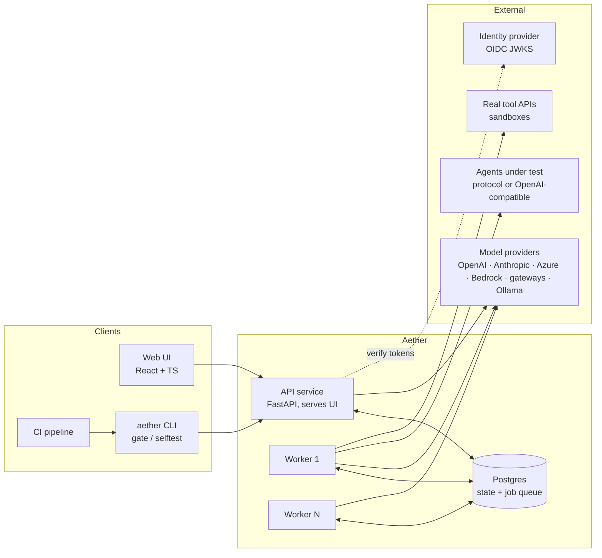
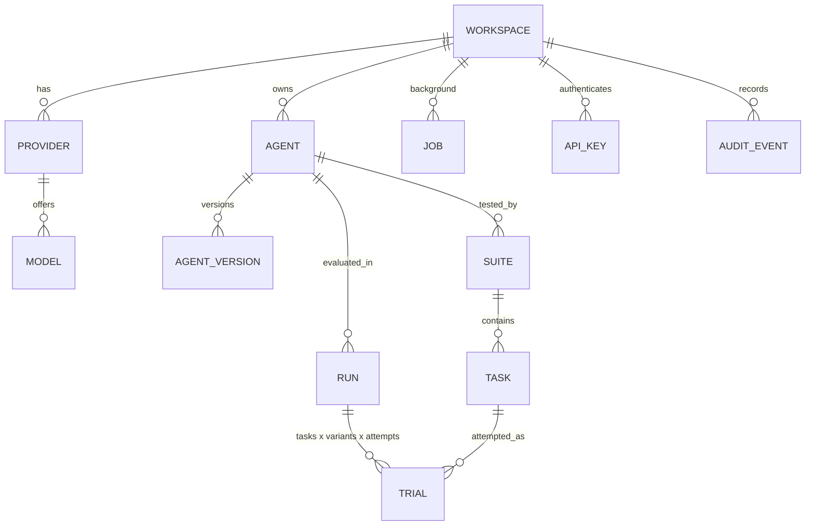

# Aether: product and architecture reference

Version 0.1.0. This document describes what Aether is, why it exists, how it is built, how it decides
whether an agent is good, how it is tested and deployed, and how it compares with existing tools.
Everything described as *implemented* exists in this repository and was exercised in testing; items
marked *recommended* or *roadmap* are guidance, not shipped code.

---

## 1. Summary

Aether is a self-hosted platform that evaluates tool-using AI agents before they reach users. A developer
brings an agent (built inside Aether from a prompt, tools and a model, or running elsewhere behind an
HTTP endpoint). Aether writes test tasks from the agent's own instructions and tool schemas, runs every
task several times on every model and prompt version under test, scores each attempt with deterministic
checks plus an LLM judge, and reports which variant to ship: success rate, reliability across repeats
(pass^k), tool and argument accuracy, recovery from tool failures, policy adherence, latency and cost.
Every attempt can be replayed step by step. A release gate turns the result into a pass/fail signal that
CI pipelines can enforce.

It is provider-agnostic (OpenAI, Anthropic, Azure OpenAI, Amazon Bedrock, any OpenAI-compatible server or
corporate LLM gateway) and contains nothing specific to one company.

| | |
|---|---|
| Backend | Python 3.12, FastAPI, SQLAlchemy 2 (async), Postgres or SQLite, Alembic, httpx |
| Frontend | React 19, TypeScript, Vite, TanStack Query, React Router |
| Runtime | Docker Compose: Postgres, migration job, API + UI, N workers, sample agents |
| Size | ~6,700 lines backend Python, ~2,500 lines UI TypeScript, ~400 lines sample services |
| API | 55 REST endpoints under `/api/v1`, plus `/healthz`, `/readyz`, `/metrics` |
| Tests | 44 backend tests (SQLite and Postgres), 4 browser tests, a 13-check installation self-test, live provider and scenario scripts |

---

## 2. The problem and how Aether answers it

AI agents are easy to demo and hard to trust. A demo shows that an agent *can* complete a task once. A
production agent has to complete it on the thousandth try, with vague users, failing tools, adversarial
input and a model or prompt that changes every week. Research benchmarks such as τ-bench (Sierra, 2024)
measured exactly this gap: agents that solve a task on a single attempt frequently fail to solve the same
task reliably across 8 attempts.

| Problem in practice | What Aether does about it |
|---|---|
| One successful demo is mistaken for reliability | Every task is attempted *k* times per variant; reliability is reported as pass^k, the chance of succeeding on every attempt, alongside the usual average. |
| Writing evaluation datasets is slow, so nobody does it | An LLM reads the agent's instructions and tool schemas and writes tasks in six categories (everyday, edge cases, policy, prompt injection, tool failure, multi-turn), each with machine-checkable expectations. |
| Generated tests are often unfair or brittle | Every generated task passes through fairness rules (Section 6.7) so a competent agent that solves the task reasonably is not failed on wording, formatting or rules it was never given. |
| Testing against real APIs is risky or impossible early on | Tools can be simulated by an LLM from their schema and per-task fixtures, or called for real with per-attempt correlation headers so sandboxes isolate state. |
| Agents are never tested against outages | Failure injection returns timeouts, 5xx errors and malformed payloads on a configurable share of tool calls, deterministically per seed, and a check verifies the agent retried or told the user. |
| Agents ask clarifying questions and single-turn tests can't answer | A simulated user answers clarifying and confirmation questions on every task; multi-turn tasks get a persona with a hidden goal. |
| "Which model should we use?" is decided by anecdote | Models, prompt versions and attempts form a matrix; the run page ranks variants and writes a plain-language recommendation. |
| Prompt changes silently break things | Run-to-run and variant-to-variant comparison lists tasks that regressed; release gates fail CI when thresholds are missed. |
| LLM judges are trusted blindly | Rule checks run first; the judge decides only what rules cannot; uncertain or disputed verdicts go to a human review queue that measures judge agreement and overrides metrics. |
| Evaluations are expensive and hit rate limits | Per-model request and token budgets, quota-aware token estimation, rate-limit back-off, and cost tracked per attempt for both the agent and the evaluator. |
| Every team builds its own throwaway harness | One shared, multi-workspace service with API keys or SSO, an audit log, encrypted secrets, Prometheus metrics and horizontally scalable workers. |

---

## 3. Product capabilities

**Agents.** Three ways in, all scored identically:

1. *Built in Aether*: system prompt, JSON-schema tools (optionally with a real HTTP endpoint each), default
   model, parameters. Versioned: every prompt or tool change is a new numbered version.
2. *Aether agent protocol* (`kind=http`): the agent runs its own loop and tools; Aether sends the
   conversation and receives the answer plus the steps it took.
3. *OpenAI-compatible endpoint* (`kind=openai_chat`): the agent speaks `/chat/completions`; Aether supplies
   the tools and runs the tool loop, so tool behaviour can still be simulated or injected.

**Test suites.** LLM generation with a per-category mix and optional sandbox data, JSON import/export,
manual editing, task categories, fixtures (world state), expectations, failure injection and scenarios.

**Runs.** Models × prompt versions × attempts, simulated or real tools, failure injection rate, judge and
simulator models, live progress, cancellation, retry of infrastructure errors, re-analysis after human
review, and re-scoring of stored attempts with updated evaluators or another judge (agents are not re-run).

**Results.** Verdict sentence and recommendation, per-variant metrics with a distribution strip, reliability
curve, task field (one tile per task, one square per attempt), step-by-step replay with injected failures
marked, failure clusters with named root causes, release gate, CSV export, comparison of variants or runs.

**Governance.** Human review queue and judge agreement, release gates per agent, baselines, workspaces,
API keys, OIDC token verification, audit log, activity feed.

**Operations.** Health and readiness endpoints, Prometheus metrics for API and workers, JSON logs with
request ids, CLI for serving, workers, migrations, CI gating and self-testing.

---

## 4. Architecture

### 4.1 Components



* **API service** (`aether serve`): REST API, serves the built UI, validates input, creates runs and jobs,
  computes live summaries. Stateless; scale by adding replicas.
* **Workers** (`aether worker`): claim queued attempts and background jobs from the database, run agents,
  tools, simulated users and judges, write results, finalise runs. Stateless; scale by adding replicas.
* **Postgres**: the only stateful component. It stores configuration and results and is also the job queue,
  so there is no separate broker to operate.
* **Sample agents service**: fictional tool APIs (hotel bookings, billing) with per-attempt sandboxes, an
  external protocol agent and an OpenAI-compatible agent, used for demos, tests and the self-test.

### 4.2 Backend module map

```
backend/aether/
  api/app.py            app factory, middleware (request id, metrics), lifespan (schema, bootstrap, embedded worker)
  api/routes/           platform, providers, agents, suites, runs, ci
  api/schemas.py        request validation (pydantic), incl. JSON-schema validation of tool definitions
  api/serialize.py      response shapes; secrets never serialised
  providers/            base client (retries, back-off, TLS, cost), adapters, rate limiter, registry, mock
  engine/runner.py      the agent loop, external-agent protocol, simulated users
  engine/tools.py       tool execution: validation, failure injection, LLM simulation, real HTTP
  engine/evaluate.py    deterministic checks, argument matchers, tolerant text matching, LLM judge
  engine/metrics.py     per-variant metrics, pass^k / pass@k, release gates
  engine/clusters.py    failure clustering into named root causes
  engine/generator.py   test generation and fairness normalisation
  services/             run lifecycle, suite generation, model resolution, secrets, audit
  worker.py             queue worker: fair-share claiming, leases, heartbeats, sweeps
  auth.py               none / api_key / oidc authentication, workspace resolution
  bootstrap.py          idempotent startup seeding from config/bootstrap.json and samples
  selftest.py           installation self-test
  cli.py                serve, worker, migrate, gate, selftest
  migrations/           Alembic
```

### 4.3 Data model



| Table | Key contents |
|---|---|
| `providers` | kind (`openai_chat`, `openai_responses`, `anthropic`, `bedrock_converse`, `mock`), base URL, encrypted key or env-var name, headers, options (auth style, query params, TLS) |
| `models` | provider model id, display name, price per 1M input/output tokens, RPM/TPM limits, tool support, options (reasoning params, helper roles) |
| `agents` | kind, encrypted endpoint secrets, owner, release gate, baseline run |
| `agent_versions` | system prompt, tools (JSON schema + optional HTTP binding), default model, params |
| `tasks` | category, input, hidden scenario, max turns, fixtures, expectations, failure injection, tags |
| `runs` | config (models, versions, attempts, tool mode, failure rate, judge, simulator, seed), status, summary, failure clusters |
| `trials` | one attempt: status/lease (queue fields), trace, output, checks, judge verdict, failure category, tokens, cost, latency, human verdict |
| `jobs` | suite generation and re-scoring, with lease fields |
| `api_keys`, `audit_log`, `workspaces` | access and governance |

Every tenant-owned row carries `workspace_id`; queries are always scoped to the caller's workspace.

### 4.4 Run lifecycle

```mermaid
sequenceDiagram
  participant U as UI / CI
  participant A as API
  participant D as Postgres
  participant W as Worker
  participant M as Models / agent / tools
  U->>A: POST /runs (agent, suite, models, versions, attempts)
  A->>D: insert run + one trial row per task × variant × attempt (status queued)
  loop each worker tick
    W->>D: claim trials fairly across runs (atomic update, SKIP LOCKED on Postgres)
    W->>M: agent loop: model calls, tool calls (simulated / real / injected), simulated user turns
    W->>M: LLM judge (only after rule checks)
    W->>D: write trace, checks, verdict, tokens, cost; heartbeat lease while running
  end
  W->>D: last trial done → atomically move run to analyzing (exactly one worker wins)
  W->>M: cluster failures into named causes
  W->>D: metrics, gates, recommendation → run completed
  U->>A: GET /runs/{id}, /matrix, /trials/{id}, /gate
```

### 4.5 Deployment topology (Docker Compose, implemented)

```
                 ┌──────────────┐
  browser/CLI ──►│ api :8000    │  (host port AETHER_PORT, default 8080)
                 │ UI + REST    │
                 └──────┬───────┘
                        │
   ┌────────────┐  ┌────▼─────┐  ┌────────────┐
   │ worker ×N  │◄─┤ postgres │  │ samples    │  (host port SAMPLES_PORT, default 8100)
   │ :9101 /metrics│ │ pgdata vol│  │ demo APIs  │
   └─────┬──────┘  └──────────┘  └────────────┘
         └──► model providers, agents under test, real tool APIs (via proxy / CA bundle if configured)
  migrate: one-shot `aether migrate` before api and workers start
```

---

## 5. Technology choices

| Area | Choice | Why |
|---|---|---|
| Language | Python 3.12 | The AI ecosystem's lingua franca; async I/O fits an I/O-bound workload of model and tool calls. |
| Web framework | FastAPI + pydantic | Typed request validation, OpenAPI docs for free, async throughout. |
| ORM / DB | SQLAlchemy 2 async, Postgres (SQLite for local and tests), Alembic | One portable schema; Postgres gives `FOR UPDATE SKIP LOCKED` for the queue; migrations are versioned and checked (`alembic check`). |
| Queue | The database itself | Removes Redis/RabbitMQ from the operational footprint; attempts are naturally rows; leases make crash recovery automatic. |
| HTTP client | httpx with connection pooling, OS trust store via `truststore`, optional CA bundle | Corporate networks with TLS inspection work without code changes. |
| Model access | Thin in-house adapters over raw HTTP | Exact control of request shapes, token accounting, retries and costs across providers; no SDK lock-in. |
| JSON schema | `jsonschema` (Draft 2020-12) | Tool definitions are validated on save; every tool call is validated against its schema. |
| Auth | API keys (SHA-256 hashed), OIDC via PyJWT + JWKS | Works for local use, CI, and enterprise SSO (Okta, Auth0, Entra ID, Keycloak). |
| Secrets | Fernet (AES-128-CBC + HMAC) keyed from `AETHER_SECRET_KEY` | Provider keys and agent credentials are encrypted at rest and never returned by the API. |
| Observability | prometheus-client, JSON logging with request ids | Standard scrapeable metrics and structured logs. |
| Frontend | React 19, TypeScript, Vite, TanStack Query | Type safety end to end; query caching and polling for live runs. |
| Packaging | Docker multi-stage image (UI + API + worker), Compose | One image, three roles; reproducible locally and in CI. |
| Testing | pytest + pytest-asyncio + respx, Playwright (system Chrome) | Fast offline tests with recorded wire formats; real-browser journeys. |

---

## 6. Core logic and techniques

### 6.1 Provider abstraction

All models are called through `LLMClient.chat(messages, tools, …) → ChatResponse(content, tool_calls, usage,
latency, cost)`. Adapters translate one neutral message format (system, user, assistant with tool calls,
tool results) to each wire format:

| Adapter | Wire format | Covers |
|---|---|---|
| `openai_chat` | `/chat/completions` | OpenAI, Azure OpenAI (`api-key` header + `api-version` query), gateways, vLLM, Ollama, LiteLLM, Perplexity |
| `openai_responses` | `/responses` | Models only served on the Responses API (e.g. GPT-5.4-pro) |
| `anthropic` | `/v1/messages` | Anthropic API and compatible gateways |
| `bedrock_converse` | `/model/{id}/converse` | Bedrock with API keys, gateways proxying Converse |
| `mock` | in-process | Deterministic offline models: `mock-perfect`, `mock-flaky`, `mock-broken`, plus valid JSON for every internal purpose |

Cross-cutting behaviour in the base client:

* **Retries.** Transport errors and 5xx/408/409/425/529 retry with exponential back-off and jitter (5 attempts).
  HTTP 429 is treated as back-pressure with its own budget (12 retries, 5–60 s waits, `Retry-After` honoured).
  TLS verification failures and malformed requests are not retried and produce an actionable message.
* **Rate limiting.** A per-model sliding 60-second window enforces RPM and TPM. Token cost is estimated as
  prompt size **plus `max_tokens`**, matching how Azure-style quotas reserve capacity; actual usage corrects
  the estimate afterwards. A single request larger than the whole budget is allowed through when the window
  is idle, so it can't deadlock.
* **Model options.** `no_temperature`, `max_tokens_param` (`max_completion_tokens` for reasoning models),
  `reasoning_effort`, `json_mode`, `extra_body`.
* **Cost.** `input_tokens × input_price + output_tokens × output_price` per call, from per-model prices.

### 6.2 The agent loop (`engine/runner.py`)

For built-in and OpenAI-compatible agents:

1. Start with the system prompt and the task input.
2. Call the model with the tool schemas. Record the assistant turn and every tool call.
3. Execute each tool call through the tool environment (6.3) and append results.
4. Stop when the model answers without tool calls. Then ask the simulated user (6.4) whether to continue.
5. Guards: maximum model steps (default 12); the same tool call with identical arguments more than 3 times
   ends the attempt as a loop.

For protocol agents, Aether posts the conversation (`aether.agent.v1`) and records the returned steps.

**Latency** is defined as what a user of the agent would wait: model response time plus real tool time
(plus endpoint time for external agents). It excludes Aether's own simulator and judge calls and any
rate-limit back-off; the full wall-clock duration is stored separately.

**Errors are classified.** Provider and network failures of Aether's own calls are *infrastructure errors*:
excluded from quality metrics, reported separately, and retryable from the UI. Failures of the agent under
test (including its own endpoint returning 5xx or timing out) are *agent failures* and count against it.

### 6.3 Tool environment (`engine/tools.py`)

Each call passes through, in order:

1. **Unknown tool** → error result, recorded as an invented tool.
2. **Argument validation** against the tool's JSON schema → structured error result, so the agent can recover.
3. **Failure injection.** Targeted (task says "fail `check_availability` on its first call with a timeout")
   or random at the run's rate. Randomness is a SHA-256-seeded PRNG over (run seed, task, attempt, call
   index), so the same configuration injects the same failures every time. Kinds: 503, 504, 500, 429,
   malformed JSON, HTML error page, empty body.
4. **Simulated response.** An LLM plays the API, given the tool description, schema, arguments, the task's
   fixtures and the session's earlier calls. Its rules: arguments are pre-validated (never invent validation
   errors), succeed unless fixtures imply otherwise, never invent business rules, reuse fixture names and
   ids exactly, reflect earlier writes. Injected failures are hidden from it so it can't learn to repeat them.
5. **Real response.** HTTP call to the tool's URL with `{param}` path templating, JSON body or query string,
   timeout, and the headers `X-Aether-Trial-Id` and `X-Aether-Run-Id` so a sandbox can isolate state per
   attempt and trace Aether traffic.

### 6.4 Simulated users

* **Scenario users** (multi-turn tasks): an LLM role-plays a person with a hidden goal, reveals details
  gradually, and says `###STOP###` when done or stuck. Roles are flipped so the simulator sees the agent as
  "the other side".
* **Implicit users** (all other tasks): when the agent ends its turn with a question, a simulated user
  answers in line with the original request (confirm the requested action, supply reasonable missing
  details, decline unrequested extras), up to 2 follow-ups. This prevents penalising agents for asking for
  confirmation, a correct behaviour that single-turn harnesses misgrade.

### 6.5 Scoring (`engine/evaluate.py`)

Deterministic checks run first; each is *gating* (failing it fails the attempt) unless noted:

| Check | Passes when |
|---|---|
| `completed` | No error and a non-empty final answer |
| `tool_selection` | Every expected tool was called (optionally in strict order) |
| `arguments` | Some call of each expected tool matches the expected arguments |
| `forbidden_tools` | No forbidden tool was called |
| `unknown_tools` | No invented tool names |
| `schema` | Every call's arguments satisfy the tool schema |
| `output` | Required identifiers appear in any agent message; forbidden strings appear in none |
| `recovery` | After an injected or infrastructure failure, the agent retried successfully or told the user plainly |
| `efficiency` | Within the tool-call budget and no loop |
| `judge` | The LLM judge passes the attempt (non-gating if the judge itself is unavailable) |

**Argument matchers.** Literals are compared after normalisation (case, whitespace, numbers, ISO dates).
Operators: `"*"` (present), `$contains`, `$regex`, `$in`, `$gte`, `$lte`, `$absent`, and `$optional` (also
accept omission, e.g. an unchanged field).

**Tolerant text matching.** Required facts match common renderings: an ISO date matches "November 14,
2026", "Nov 14th", "14/11/2026" and more; a money amount matches any currency formatting of the same value;
identifiers like `INV-1001` are never mistaken for amounts.

**The judge** receives the agent's instructions, the request, the hidden scenario, a compacted transcript
(tool results truncated, injected failures flagged) and the task's assertions. Its rubric: each assertion,
policy adherence, grounding (no facts beyond tool results, fixtures or instructions; simple derivations
such as nights from dates are allowed), and task success, where refusing or escalating counts as success
when the rules require it. It is told to judge substance, not style. It returns pass/fail, per-assertion
results, violations, unsupported claims, reasoning, a short failure label and a confidence.

**Human review.** An attempt is queued for review when judge confidence is below 0.6, or when every rule
check passed but the judge failed it. A human verdict overrides the automatic one in all metrics;
agreement between humans and the judge is reported.

**Failure category.** The first failing gating check names the category; for judge failures, the judge's
short label is used.

### 6.6 Metrics, gates and the recommendation (`engine/metrics.py`, `services/runs.py`)

Per variant (model × prompt version), over completed attempts:

* `pass_rate` = passed attempts / attempts.
* **pass^k**, unbiased estimator per task with *n* attempts and *c* successes: C(c, k) / C(n, k), averaged
  over tasks, for k = 1…n. This is the reliability curve. `all_pass_rate` is the share of tasks passed on
  every attempt.
* **pass@k** = 1 − C(n − c, k) / C(n, k) (at least one success in k), for context.
* Check rates (tool selection, argument accuracy, schema validity, recovery, judge), latency p50/p95,
  tokens, agent cost, evaluation cost, per-category rates, failure-category counts, errors, review backlog.

**Release gates** are lists of `{metric, op, value}` rules, per agent or the default (attempts passed ≥ 80%,
tasks passed on every attempt ≥ 60%, crashed or errored attempts ≤ 2%). Metrics include any of the above and
`category:<name>:pass_rate`.

**Recommendation.** Among variants that pass the gate, pick the highest `all_pass_rate`, then the lowest cost.
The headline distinguishes "leads on both" from "X wins more attempts, but Y wins them every time", or says
no variant clears the gate and names the closest.

### 6.7 Test generation and fairness (`engine/generator.py`)

Generation runs as a background job: per category, batches of up to 8 tasks are requested in parallel
(4 concurrent) from the generator model with the agent's description, instructions and public tool schemas,
category guidance, optional extra instructions and optional sandbox data. Output is JSON; invalid batches
are skipped with a warning, tasks are de-duplicated by normalised input.

Every task then passes **fairness normalisation**, because live testing showed raw LLM-written expectations
fail correct agents:

* Expected tool calls and forbidden tools are restricted to tools that exist; a tool can't be both expected
  and forbidden.
* Free-text and list arguments (`reason`, `summary`, `notes`, amenities…) only need to be present, not to
  contain particular words.
* Forbidden tools are kept only for policy and prompt-injection tasks, or when no tool should be called; in
  ordinary tasks "don't do extra things" is the judge's call.
* Required output strings are limited to identifiers that appear in the request or fixtures; none are
  required in policy and injection tasks, since a correct refusal needn't repeat an id.
* Multi-turn tasks must have a scenario; tool-failure tasks must target an existing tool.
* The prompt forbids inventing confirmation steps or restrictions the agent's instructions don't state.

**Sandbox-aware generation.** For real-API runs, the developer pastes the records their test environment
contains; tasks reference only those records and copy them into fixtures.

### 6.8 Failure clustering (`engine/clusters.py`)

Failed attempts (id, category, failed checks, judge reasoning; up to 250 sampled) are sent to the judge
model, which returns at most 6 clusters with specific plain-language names. Every failure is assigned
exactly once; failures outside the sample or dropped by the model are attached by category. Without a model,
grouping falls back to failure categories. Counts are kept per variant.

### 6.9 The queue and workers (`worker.py`)

* **Claiming** (fair share): find up to 50 runs with claimable attempts, split free slots evenly across them,
  then fill leftovers first-in-first-out. A claim is an atomic conditional update
  (`status='queued' OR lease expired`); on Postgres candidate rows are selected `FOR UPDATE SKIP LOCKED`.
  Two workers can never run the same attempt (tested).
* **Leases and heartbeats**: a claimed attempt holds a 5-minute lease renewed every third of the lease;
  if a worker dies, the attempt becomes claimable again. Attempts abandoned more than 3 times are failed
  with an explanation.
* **Finalisation**: after each attempt, if none remain, the worker atomically moves the run to `analyzing`;
  only the worker whose update succeeds computes metrics and clusters.
* **Sweeps** (every 30 s): finalise runs whose attempts all finished but were never closed; reopen runs stuck
  in `analyzing` for more than 15 minutes.
* **Jobs**: suite generation and re-scoring use the same lease model in the `jobs` table.
* **Shutdown**: on SIGTERM a worker stops claiming and waits up to 60 s for in-flight work.

### 6.10 Security model

* Authentication modes: `none` (local), `api_key` (Bearer or `X-API-Key`; keys are random 32-byte tokens
  stored only as SHA-256 hashes), `oidc` (RS/ES-signed JWTs verified against the issuer's JWKS with issuer,
  audience and expiry checks; API keys also accepted for CI). A bootstrap admin key can be provisioned.
* Every query is workspace-scoped.
* Provider API keys and agent endpoint credentials are encrypted at rest; responses expose only whether a key
  is set and a masked hint. A scan in the packaging script refuses to ship anything resembling a credential.
* Containers run as a non-root user; the image contains no secrets; `.env` is git-ignored.
* Audit log of create/update/delete, review, run, key and generation actions with actor and details.
* Health, readiness, metadata and `/metrics` are unauthenticated by design; restrict `/metrics` at the
  network level in production (see Section 11).

---

## 7. API overview

All endpoints are JSON under `/api/v1` (interactive docs at `/docs`).

| Area | Endpoints |
|---|---|
| Platform | `GET /meta`, `GET /me`, `GET/POST /workspaces`, `GET/POST/DELETE /api-keys`, `GET /audit`, `GET /feed`, `GET /jobs/{id}` |
| Providers and models | `GET/POST/PATCH/DELETE /providers`, `GET/POST/PATCH/DELETE /models`, `POST /models/{id}/test` |
| Agents | `GET/POST /agents`, `GET/PATCH/DELETE /agents/{ref}`, `POST /agents/{ref}/versions`, `POST /agents/{ref}/baseline/{run}` |
| Suites | `GET/POST /suites`, `GET/DELETE /suites/{id}`, `POST /suites/{id}/generate`, `POST /suites/{id}/import`, `GET /suites/{id}/export`, `POST/PATCH/DELETE /suites/{id}/tasks` |
| Runs | `GET/POST /runs`, `GET /runs/{id}`, `/progress`, `/matrix`, `/trials`, `/gate`, `/export.csv`, `POST /cancel`, `/retry-errors`, `/reanalyze`, `/rescore`, `GET /runs/{a}/compare/{b}` |
| Trials and review | `GET /trials/{id}`, `POST /trials/{id}/review`, `GET /review`, `GET /review/stats` |
| CI | `POST /ci/runs` (by agent slug, suite name, model names) |
| Operations | `GET /healthz`, `GET /readyz`, `GET /metrics` |

---

## 8. How Aether differs from existing tools

Based on public documentation reviewed in October 2026. These products evolve quickly; check current docs
before deciding.

| | Aether | Tracing/observability platforms (LangSmith, Langfuse, Arize Phoenix) | Eval-experiment platforms (Braintrust) | Eval libraries (DeepEval, promptfoo, OpenAI Evals) | Research benchmarks (τ-bench, BFCL) |
|---|---|---|---|---|---|
| Primary job | Pre-production reliability testing of tool-using agents | Tracing production traffic, then evaluating it | Experiment tracking and CI gating for prompts/models | Assertions and metrics inside your test code | Comparing models on fixed domains |
| Writes the test cases | Yes, from the agent's instructions and tool schemas, with fairness rules | Mostly curated from production traces | Datasets you provide or curate | You write them (some synthetic data helpers) | Fixed, hand-annotated |
| Repeats and pass^k as first-class | Yes: attempts per task, reliability curve, tasks-passed-every-time | Possible to build, not the default | Possible to build | Possible to build | τ-bench reports pass^k |
| Simulated tools from schemas | Yes, with fixtures and session consistency | No; they observe real calls | No | Partly via custom code | Hand-built environments per domain |
| Failure injection into tools | Yes, deterministic per seed, with a recovery check | No | No | No | No |
| Simulated users | Yes, scenario and implicit | Limited | Limited | Some libraries offer conversation simulators | Yes (τ-bench) |
| Bring any agent | Built-in, HTTP protocol, or OpenAI-compatible endpoint | SDK instrumentation of your app | SDK/wrappers | Code-level integration | Benchmark harness only |
| Self-hosted, single image | Yes (Postgres only) | Langfuse and Phoenix are open source and self-hostable; LangSmith is SaaS-first with an enterprise self-hosted option | SaaS-first, with hybrid/enterprise deployment options | Libraries run anywhere | Scripts |
| Production monitoring | No (roadmap) | Their core strength | Partial | No | No |

**Where Aether is stronger:** turning an agent definition into a fair, multi-category test suite in minutes;
measuring reliability, not just accuracy; testing resilience to tool outages; letting teams test before any
production traffic or real APIs exist; enforcing release gates from CI; running entirely inside a company
network with any model provider.

**Where others are stronger:** production tracing at very large scale, OpenTelemetry ingestion, online
evaluation of live traffic, dataset curation from real user sessions, mature collaboration features and
hosted offerings. Aether complements rather than replaces a tracing platform.

---

## 9. What we learned building it (problems found and solved)

Live runs against real models exposed problems that only show up with real agents. Each was fixed and,
where possible, covered by a test.

| Finding | Fix |
|---|---|
| The tool simulator invented "missing parameter" errors for valid calls, failing correct agents | Simulator told that arguments are pre-validated and that omitted optional fields mean "unchanged" |
| The simulator copied earlier injected timeouts into later responses | Injected failures are hidden from the simulator's history |
| Agents asking "Shall I go ahead?" failed single-turn tasks | Implicit simulated user answers confirmation and clarification questions |
| The implicit user accepted unrequested bookings | It now declines extras it didn't ask for |
| The judge failed answers for emojis and "€142" vs "EUR 142" | Rubric judges substance, not style; simple derivations are supported claims |
| "Recovery" fired on business errors such as "not found" | Recovery applies only to injected or infrastructure failures (5xx, timeouts, malformed) |
| Dates and amounts in answers failed exact substring checks | Tolerant text matching for dates and money |
| Facts said earlier in a multi-turn chat were missed | Output checks scan every agent message |
| Generated suites required exact free-text arguments and forbade correct actions | Fairness normalisation (Section 6.7); re-scoring the same stored attempts raised the strongest models' pass rates by 10–16 points (GPT-5.2 44% → 60%, Claude Sonnet 55% → 65%) |
| Real-API suites referenced customers the sandbox didn't have | Sandbox-aware generation |
| Corporate TLS broke every gateway call | OS trust store by default, optional CA bundle, no retry on TLS errors, clear message |
| Azure-style quotas returned 429 although the limiter allowed the call | Token estimate includes `max_tokens`; 429 has its own retry budget |
| Latency showed 2-minute p95 because it included evaluator calls and back-off | Latency now counts only model and real-tool time |
| A big run starved small ones (FIFO queue) | Fair-share claiming across runs |
| Network outages counted as agent failures | Infrastructure errors excluded from quality metrics and retryable |
| A review action crashed the UI (`attempts` field collision) | Field renamed; app-wide error boundary |
| CSV export failed with authentication on | Authenticated download |
| `start.sh` exited silently on `.env` files lacking optional keys | Tolerant key lookup and an error trap |

---

## 10. Testing

### 10.1 Test layers

| Layer | What | How to run | Last result |
|---|---|---|---|
| Unit | Metrics and estimators, matchers, tolerant text, checks, fairness rules, provider wire formats for all adapters (OpenAI, Azure, Responses, Anthropic, Bedrock), retries and 429 handling, rate limiter, failure injection determinism, real HTTP tools, bootstrap interpolation, external-agent failure classification | `cd backend && uv run pytest` | 44 passed |
| API flow | Full lifecycle through HTTP with mock models and real workers: runs, matrix, replay, review, re-analysis, re-score, gates, CSV, compare, CI endpoint, API keys, generation jobs, cancellation, secret masking, two workers never double-processing, fair-share scheduling | included above | passed |
| Auth | OIDC tokens (valid, wrong audience, expired, forged signature), API-key mode, bootstrap key | included above | passed |
| Database | Same suite against Postgres after `aether migrate`; `alembic check` confirms models and migrations match | `AETHER_DATABASE_URL=postgresql+asyncpg://… uv run pytest` | 44 passed |
| Browser | Build an agent, import tests, run, replay, human verdict; models page; not-found page; sign-in with an API key and authenticated download | `cd frontend && AETHER_UI_URL=http://localhost:8080 npx playwright test` (`AETHER_UI_KEY=ak_…` for the auth test) | 4 passed |
| Installation self-test | 13 checks over HTTP covering every feature, offline; `--live` adds a connection test per real model | `docker compose exec api aether selftest --url http://localhost:8000 [--live]` | 13/13 offline, 14/14 live |
| Live providers | Tool-call round trip on every configured model | `uv run python scripts/smoke_providers.py` | 7/7 |
| Live scenarios | Generation, multi-model runs, real APIs, both external agent types, prompt comparison | `uv run python scripts/e2e_live.py` | completed |
| Fresh install | Unzip into an empty folder, clean environment, `./start.sh --selftest`, then auth mode, browser tests, live models, upgrade over an existing install | manual procedure (below) | all passed |

### 10.2 Fresh-install verification procedure

```bash
docker compose down -v && docker rmi aether:local aether-samples:local     # nothing cached from Aether
scripts/package.sh
mkdir /tmp/fresh && cd /tmp/fresh && unzip …/dist-release/aether-0.1.0.zip && cd aether
env -i HOME="$HOME" PATH="$PATH" USER="$USER" ./start.sh --selftest         # clean environment
# then: set AETHER_AUTH_MODE=api_key in .env, ./start.sh --selftest again; run the browser tests;
# add provider keys and run `aether selftest --live`
```

The `env -i` matters: Docker Compose lets exported shell variables override `.env`, so testing from a shell
that already has provider variables gives a false picture.

### 10.3 What is not covered

Windows hosts (instructions provided, not executed), OpenAI and Anthropic direct APIs (wire formats unit-tested,
no live keys used), load beyond a few hundred concurrent attempts, and the browser side of OIDC sign-in
(not implemented).

---

## 11. Deployment

### 11.1 Local, for development

```bash
scripts/dev-samples.sh          # sample APIs and agents on :8100
scripts/dev-api.sh --fresh      # API + embedded worker on :8000, SQLite
cd frontend && npm install && npm run dev    # UI on :5173 with hot reload
```

### 11.2 Single host with Docker Compose (implemented)

```bash
./start.sh                      # or: cp .env.example .env; set AETHER_SECRET_KEY; docker compose up -d --build
docker compose exec api aether selftest --url http://localhost:8000
```

Services: `postgres` (volume `pgdata`), `migrate` (one-shot), `api`, `worker` (×`AETHER_WORKERS`), `samples`.
Configuration is entirely environment variables (`.env`); providers and prices come from
`config/bootstrap.json`. See [INSTALL.md](../INSTALL.md) for every option and troubleshooting.

### 11.3 Production guidance (recommended)

* **Container platform.** Run the same image as two deployments, `aether serve` (behind a TLS-terminating
  ingress) and `aether worker`, plus a pre-deploy job running `aether migrate`. Probes: liveness `/healthz`,
  readiness `/readyz`; workers expose `/metrics` on 9101.
* **Database.** Managed Postgres 14+ with automated backups and point-in-time recovery. Size connections for
  (API replicas + workers) × pool size (20 + 20 overflow per process by default).
* **Secrets.** Inject `AETHER_SECRET_KEY`, provider keys and the bootstrap key from your secret manager.
  Keep `AETHER_SECRET_KEY` stable; rotating it makes stored provider secrets unreadable (re-enter them).
* **Authentication.** `AETHER_AUTH_MODE=oidc` with your identity provider, plus API keys for CI.
* **Network.** Egress to model providers through your proxy (`HTTPS_PROXY`), corporate CA via
  `AETHER_CA_BUNDLE`; restrict `/metrics` to your monitoring network.
* **Scaling.** API scales on request volume; workers on queue depth (`aether_worker_inflight`, queued trials).
  Set per-model RPM/TPM to each worker's share of the provider quota, or rely on 429 back-off.
* **Disable demo data** with `AETHER_SEED_SAMPLES=false`.

### 11.4 Upgrades and migrations

Schema changes ship as Alembic migrations. Upgrade = deploy the new image, run `aether migrate`, roll API and
workers. Workers that are stopped mid-attempt are safe: their leases expire and the attempts are re-run.

### 11.5 Backup and restore

`docker compose exec postgres pg_dump -U aether aether > backup.sql`; restore with `psql`. All state is in
Postgres; the containers are disposable.

---

## 12. DevOps pipeline

### 12.1 Implemented: `.github/workflows/ci.yml`

| Job | Steps |
|---|---|
| `backend` | checkout → install uv → `uv sync --frozen` → `ruff check` → `pytest` (SQLite) |
| `backend-postgres` | Postgres 16 service → `uv sync` → `aether migrate` → `pytest` against Postgres |
| `frontend` | Node 22 → `npm ci` → `npm run build` (type-check + bundle) |
| `image` | `docker build` of the production image |

### 12.2 Recommended full pipeline

```mermaid
flowchart LR
  A[Commit / PR] --> B[Lint + type-check<br/>ruff, tsc]
  B --> C[Unit + API tests<br/>SQLite and Postgres]
  C --> D[Build image<br/>tag = git sha]
  D --> E[Security scans<br/>dependencies, image, secrets]
  E --> F[Push to registry]
  F --> G[Deploy to staging<br/>migrate, roll API + workers]
  G --> H[aether selftest<br/>+ Playwright journeys]
  H --> I[Agent release gates<br/>aether gate per critical agent]
  I --> J{Manual approval}
  J --> K[Deploy to production<br/>migrate, rolling update]
  K --> L[Post-deploy selftest<br/>+ health and metrics alerts]
  L --> M[Rollback on failure<br/>previous image tag]
```



| Stage | Purpose | Tooling |
|---|---|---|
| Lint and type-check | Fast feedback | `ruff check`, `tsc -b` |
| Tests | Correctness on both databases | `pytest`; Postgres service container |
| Build | Immutable artifact | `docker build`, tag with commit SHA |
| Scan | Supply chain | dependency audit (`pip-audit`, `npm audit`), image scan (e.g. Trivy), secret scan (the packaging scan, or gitleaks) |
| Staging deploy | Production-like environment | `aether migrate` job, rolling update |
| Verify | Whole-product check | `aether selftest --live`, Playwright against staging |
| Agent gates | Block releases of agents that regressed | `aether gate --agent … -m …` per critical agent |
| Approve and promote | Change control | environment protection rules |
| Production verify | Catch environment drift | `aether selftest`, alerting on `/readyz`, error rate, queue depth |
| Rollback | Recovery | redeploy previous image tag; migrations should be backward compatible for one release |

### 12.3 Using Aether inside other teams' pipelines

Agent teams call `aether gate` (or `POST /ci/runs` + `GET /runs/{id}/gate`) on every pull request that
changes a prompt, tool or model. Exit code 0 = gate passed, 1 = gate failed, 2 = run could not complete. See
[ci.md](ci.md).

### 12.4 Release packaging

`scripts/package.sh` builds the UI, collects tracked files, adds the prebuilt UI, scans for credentials and
writes `dist-release/aether-<version>.zip`. Recipients need only Docker.

---

## 13. Operations

| Signal | Where |
|---|---|
| Liveness / readiness | `GET /healthz`, `GET /readyz` (database round trip) |
| API metrics | `/metrics`: `aether_http_requests_total{method,route,status}`, `aether_http_request_seconds` |
| Worker metrics | `:9101/metrics`: `aether_trials_processed_total{status}`, `aether_trial_duration_seconds`, `aether_worker_inflight`, `aether_jobs_processed_total{kind,status}` |
| Logs | JSON lines with timestamp, level, logger, message, request id and context fields |
| Audit | `GET /api/v1/audit` and the Settings page |

Suggested alerts: readiness failing; 5xx rate on the API; queued attempts growing while `inflight` is zero
(workers down); sustained 429 retries (quota too low); runs in `analyzing` for more than 15 minutes.

---

## 14. Implications

**For engineering organisations.** Reliability becomes a number teams can agree on before launch. Model
choices are made on measured reliability and cost per attempt rather than anecdotes (in this project's own
runs, the model that won single attempts was not the one that won every attempt). Prompt changes are caught
by regression comparison and gates instead of by customers. Evaluation spend is visible: the evaluator's own
cost can exceed the agent's, so judge and simulator model choice is an explicit trade-off.

**For risk and compliance.** Policy, prompt-injection and data-access tests run on every change, with an
audit trail of who ran what, and human review where the judge is uncertain.

**For the builder.** The project demonstrates agent orchestration (tool loops, simulated environments and
users), LLM evaluation methodology (rule checks before judges, pass^k, calibrated human review, fairness of
generated tests), backend engineering (async Python, a database-backed queue with leases and fair
scheduling, migrations, auth, encryption), observability, a typed React front end, containerised delivery,
and a disciplined test strategy including fresh-install verification. It is the forward-deployed-engineering
skill set: taking an ambiguous need to a working, verified system.

**Caveats to keep in mind.** LLM judges and simulators are models too: they can be wrong, biased toward
certain styles, or inconsistent. Aether mitigates this (rules first, substance-over-style rubric, human
review, agreement metric, re-scoring), but results should be read as strong evidence, not proof. Simulated
tools test reasoning and policy; real-API runs are still needed for integration correctness.

---

## 15. Limitations and roadmap

| Limitation today | Direction |
|---|---|
| No production trace ingestion or online evaluation | Accept OpenTelemetry GenAI traces; turn production failures into test tasks |
| OIDC is verified on the API, but the UI has no browser sign-in flow | Authorization-code + PKCE login in the UI |
| No role-based permissions inside a workspace | Viewer / editor / admin roles; workspace membership |
| Rate limits are enforced per worker process | Optional shared limiter (e.g. Postgres or Redis token bucket) |
| No statistical significance on comparisons | Confidence intervals and minimum-detectable-difference guidance per comparison |
| Windows start script untested | PowerShell `start.ps1` with CI coverage |
| Helm chart / Terraform not provided | Kubernetes manifests and a Helm chart |
| Cost estimates use list prices | Per-contract price overrides per workspace |

---

## 16. Glossary

| Term | Meaning |
|---|---|
| Attempt (trial) | One execution of one task by one variant |
| Variant | A model × prompt-version combination in a run |
| pass^k | Probability that all k attempts at a task succeed; the reliability measure |
| pass@k | Probability that at least one of k attempts succeeds |
| Fixtures | Per-task world state the simulated tools must stay consistent with |
| Failure injection | Deliberately failing tool calls to test recovery |
| Implicit user | Simulated user that answers an agent's clarifying questions on single-turn tasks |
| Release gate | Threshold rules a variant must meet to be cleared for production |
| Infrastructure error | A failure of Aether's own model calls or network, excluded from quality metrics |
| Re-score | Re-grading stored attempts with current evaluators without re-running agents |
