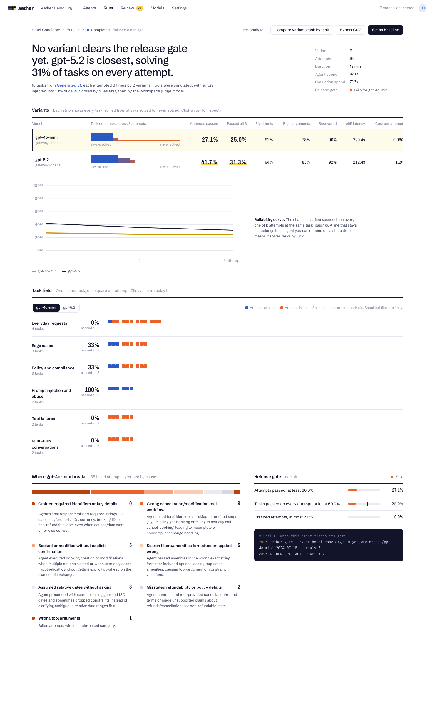

# Aether

**Find out whether your AI agent works every time, not just in the demo.**

Aether is a self-hosted platform for evaluating tool-using AI agents. It writes test tasks from your agent's
own instructions and tools, runs every task several times on every model and prompt version you choose, and
tells you which one to ship: tool-calling accuracy, reliability across repeats (pass^k), recovery from tool
failures, policy adherence, latency and cost, with every attempt replayable step by step.

It works with any model provider and any company: OpenAI, Anthropic, Azure OpenAI, Amazon Bedrock, Ollama/vLLM,
or an internal OpenAI-compatible LLM gateway. Nothing about a specific organisation is built in.



## Why

A demo proves an agent *can* do something once. Production needs it to do the right thing on the 1,000th try,
when the user is vague, when a tool times out, and when someone tries to talk it out of its rules. Research
benchmarks such as τ-bench show that agents which pass 80% of tasks once often pass under 30% of them reliably
across 8 attempts. Aether measures that gap for your own agent, before your users do.

## What it does

| | |
|---|---|
| **Bring any agent** | Build one in Aether (prompt + tools + model), connect an agent you already run over HTTP (Aether agent protocol), or point at any OpenAI-compatible endpoint. |
| **Generated test suites** | An LLM reads the agent's instructions and tool schemas and writes everyday, edge-case, policy, prompt-injection, tool-failure and multi-turn tasks, each with checkable expectations. Import and edit tasks as JSON too. |
| **Simulated or real tools** | Tools can be simulated by an LLM from their schema and per-task fixtures, or called for real. Real calls carry `X-Aether-Trial-Id` so sandboxes can isolate state per attempt. |
| **Failure injection** | Timeouts, 5xx errors and malformed responses on a configurable share of tool calls, deterministic per seed. |
| **Simulated users** | Multi-turn tasks use an LLM persona with a hidden goal; single-turn tasks get a simulated user who answers clarifying and confirmation questions. |
| **Scoring** | Deterministic checks first (right tools, argument matching with tolerant matchers, JSON-schema validity, forbidden tools, recovery, loops), then an LLM judge for policy, grounding and assertions. |
| **Reliability metrics** | pass^k and pass@k (unbiased estimators), per-category rates, tool and argument accuracy, recovery rate, p50/p95 agent latency, tokens and cost per attempt. |
| **Failure clustering** | Failed attempts are grouped into a handful of named root causes. |
| **Release gates and CI** | Per-agent thresholds; `aether gate` exits non-zero in CI when a change regresses. |
| **Compare** | Model vs model, prompt v1 vs v2, run vs run, task by task with regressions highlighted. |
| **Human review** | Low-confidence or disputed judge verdicts go to a review queue; human verdicts override metrics and measure judge agreement. |
| **Re-score** | Re-grade stored attempts with updated evaluators or a different judge without re-running agents. |
| **Enterprise** | Workspaces, API keys, OIDC SSO (Okta, Auth0, Entra ID, Keycloak), encrypted secrets, audit log, Prometheus metrics, structured logs, Postgres, horizontally scalable workers, rate-limit aware. |

## Quick start (Docker)

```bash
./start.sh                        # creates .env, builds, starts, waits until ready
open http://localhost:8080
docker compose exec api aether selftest --url http://localhost:8000   # verify every feature
```

With no provider keys, Aether runs end to end on its offline mock models, so you can explore every screen.
Add `OPENAI_API_KEY`, `ANTHROPIC_API_KEY` or the `GATEWAY_*` variables to `.env` to use real models;
providers are declared in [`config/bootstrap.json`](config/bootstrap.json) and can also be added in the UI
under **Models**. Full instructions, team setup and troubleshooting: **[INSTALL.md](INSTALL.md)**.

Scale workers with `AETHER_WORKERS=4` in `.env`. Build a shareable zip with `scripts/package.sh`.

## Local development

Requirements: Python 3.12 with [uv](https://docs.astral.sh/uv/), Node 20.19+.

```bash
scripts/dev-samples.sh            # sample tool APIs + external agents on :8100
scripts/dev-api.sh --fresh        # API + embedded worker on :8000 (SQLite)
cd frontend && npm install && npm run dev   # UI on :5173
```

Tests:

```bash
cd backend && uv run pytest                # unit + API flow tests (offline)
uv run python scripts/smoke_providers.py   # live round trip for every configured provider
uv run python scripts/e2e_live.py          # live end-to-end scenarios against a running Aether
```

## How a run works

```
suite tasks x variants (model x prompt version) x attempts  ->  trials (rows in Postgres = the job queue)
workers claim trials with FOR UPDATE SKIP LOCKED + leases  ->  agent loop  ->  tools (simulated | real | injected failure)
                                                           ->  simulated user turns  ->  rule checks  ->  LLM judge
last trial finished  ->  metrics, gates, failure clusters, recommendation
```

Workers coordinate only through the database: run as many as you like, kill them at any time; leases
expire and abandoned attempts are picked up again. Provider 429s are treated as back-pressure, and
per-model RPM/TPM budgets keep each worker under your quota.

## Connecting an agent you already run

**Aether agent protocol** (your agent runs its own loop and tools):

```http
POST https://your-agent/aether
{ "protocol": "aether.agent.v1", "session_id": "...", "task_id": "...",
  "messages": [{"role": "user", "content": "Where is parcel TRK-1001?"}],
  "context": {"fixtures": {}, "tool_mode": "simulated"} }

200 OK
{ "output": "It's in transit and arrives on 14 November.",
  "steps": [{"type": "tool_call", "name": "track_parcel", "arguments": {"tracking_id": "TRK-1001"},
             "result": {"status": "in_transit", "eta": "2026-11-14"}, "latency_ms": 85}],
  "usage": {"input_tokens": 812, "output_tokens": 95}, "cost_usd": 0.0004 }
```

For multi-turn tasks Aether calls again with the full message history and the same `session_id`.

**OpenAI-compatible endpoint**: if your service speaks `/chat/completions`, register its base URL; Aether
sends the tools you declare, executes tool calls (simulated or real) and runs the loop.

## CI

```yaml
# .github/workflows/agent-eval.yml
- run: pip install "aether @ git+https://github.com/<you>/aether#subdirectory=backend"
- run: aether gate --agent hotel-concierge -m openai/gpt-4o-mini --trials 3
  env:
    AETHER_URL: ${{ vars.AETHER_URL }}
    AETHER_API_KEY: ${{ secrets.AETHER_API_KEY }}
```

`aether gate` starts a run on the agent's newest suite, waits, prints every gate rule and exits `1` if the
gate fails (`2` if the run could not complete). See [`docs/ci.md`](docs/ci.md).

## Configuration

All settings are environment variables prefixed `AETHER_` (see [`backend/aether/config.py`](backend/aether/config.py)).

| Variable | Purpose |
|---|---|
| `AETHER_DATABASE_URL` | `postgresql+asyncpg://...` in production; SQLite for local use |
| `AETHER_SECRET_KEY` | Encrypts provider and endpoint secrets at rest |
| `AETHER_AUTH_MODE` | `none`, `api_key` or `oidc` (+ `AETHER_OIDC_ISSUER`, `AETHER_OIDC_AUDIENCE`, `AETHER_OIDC_JWKS_URL`) |
| `AETHER_BOOTSTRAP_FILE` | JSON file of providers, models, prices, quotas and helper-role defaults |
| `AETHER_TLS_TRUST` / `AETHER_CA_BUNDLE` | Use the OS trust store or an extra CA bundle for corporate TLS |
| `AETHER_WORKER_CONCURRENCY` | Parallel attempts per worker |
| `AETHER_ORG_NAME` | Shown in the UI |

## Project layout

```
backend/        FastAPI API, engine, providers, worker, CLI, Alembic migrations, tests
frontend/       React + TypeScript UI
sample_agents/  Fictional sample tool APIs and external agents used for demos and tests
config/         Provider bootstrap file
```

## Licence

MIT. All sample brands (Northwind Travel, Acme Cloud, Parcelwise) are fictional.
